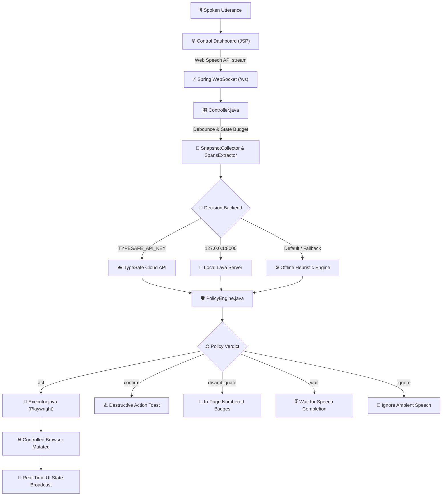

# 🎙️ Voice Browser (Java Edition)

> **Talk to a real browser — it acts before you finish the sentence.**

A high-performance, real-time voice-driven web browser automation application built with **Java 21**, **Spring Boot 3**, and **Playwright Java**. 

Continuous speech streamed word-by-word from the browser's Web Speech API is evaluated across speculative questions (intent, target element, site, completeness, safety) in ~250–350 ms. A calibrated safety policy engine then decides whether to **act**, **wait**, **confirm**, **disambiguate**, or **ignore**.

---

## 🏛️ Architecture & Control Flow

```
 mic (Chrome / Edge Web Speech API)        Spring Boot 3 Server (Port 8787)            Controlled Chromium Window
 ──────────────────────────────────   ws   ────────────────────────────────────        ──────────────────────────
 partial transcripts ───────────────▶ Controller (180 ms debounce)                    Headed Chromium via
 "go to"  "go to wiki"                     │                                           Playwright Java, persistent
 "go to wikipedia" (final)                 ▼                                           profile (.browser-profile)
                                           SnapshotCollector (≤100 elements, e01..eNN) ◀── DOM snapshot + overlay
                                           SpansExtractor (candidate regex spans)
                                           │
                                           ├───► TypeSafe AI Cloud API (Jev System One)
                                           ├───► Local Laya FastAPI Server (Python)
                                           └───► Built-in Offline Heuristic Engine
                                           │
                                           ▼
                                           PolicyEngine (calibrated safety gates) ───▶ Highlight / Toast /
 control dashboard ◀────────────────────── WebSocket State Broadcast                  Numbered Badges
 (/dashboard via JSP)                      (decision + gate bars + logs + latency)
```



---

## ✨ Key Features

- **Sub-Second Streaming Execution**: Speculative multi-question fan-out allows closed-set actions (e.g. *"go back"*, *"scroll down"*) to trigger before you even finish speaking.
- **Triple-Engine Decision Backend**:
  1. **TypeSafe AI Cloud API**: High-accuracy System One classification (`jev-1.13.0`) when `TYPESAFE_API_KEY` is provided.
  2. **Local Laya FastAPI Server**: Run local ML inference via `python3 laya_server.py` at `http://127.0.0.1:8000`.
  3. **Zero-Dependency Heuristic Engine**: Fast, deterministic offline rule evaluator that runs out-of-the-box with zero API keys or external services.
- **Strict Safety & Gate Policies**:
  - `is_command` ($\ge 0.50$): Ignores background chatter and ambient side-talk.
  - `complete` ($\ge 0.60$): Distinguishes partial commands from full intents.
  - `destructive` ($\ge 0.50$): Pauses high-risk clicks (*buy*, *delete*, *submit*, *logout*) and requests spoken confirmation (*"confirm"* or *"cancel"*).
  - `disambiguate`: Injects numbered badges on ambiguous elements so you can simply say *"two"*.
- **DOM Compaction & Viewport Sorting**: Collects interactive candidates, prioritizing viewport elements and capping text lengths to maintain minimal state overhead.
- **Built-in User Authentication & Portal**: SQLite JDBC persistence (`voicebrowser.db`) powering secure user registration, session authentication, and user profile management rendered with Spring MVC & JSP.

---

## 🛠️ Technology Stack

| Component | Technology | Version | Purpose |
| :--- | :--- | :--- | :--- |
| **Runtime** | Java OpenJDK | 21+ | Application platform |
| **Framework** | Spring Boot | 3.3.4 | Core container, MVC routing, dependency injection |
| **Automation** | Playwright Java | 1.47.0 | Headed / headless Chromium driver & CDP integration |
| **Streaming** | Spring WebSocket (JSR-356) | 3.3.4 | Low-latency bi-directional speech & state streaming |
| **Views & UI** | Tomcat Jasper & JSTL | Jakarta JSP 3.0 | Server-rendered Login, Signup, Portal & Dashboard |
| **Persistence** | SQLite JDBC | 3.46.1.3 | Raw JDBC authentication repository (`DatabaseService`) |
| **Serialization**| Jackson Databind | 2.17.2 | DTO and WebSocket message serialization |
| **Testing** | JUnit 5 Platform | 5.10.3 | Unit & integration test suite |

---

## 🚀 Getting Started

### Prerequisites

- **Java 21** or later (`java -version`)
- **Google Chrome** or **Microsoft Edge** (for the Web Speech API microphone stream)
- Embedded Maven 3.9.9 is included in `./apache-maven-3.9.9` (system Maven also works)

### 1. Clone & Configure

```bash
git clone https://github.com/moritzkremb/jev-voice-browser.git
cd jev-voice-browser

# Optional: Set TypeSafe API Key for cloud evaluation
cp .env.example .env
# Edit .env and set: TYPESAFE_API_KEY=your_key_here
```

### 2. Run the Application

Launch the Spring Boot server using the convenience wrapper:

```bash
./run.sh
# Or directly:
./run-java.sh
```

The application will start on **`http://localhost:8787`** and automatically launch a controlled Chromium window.

### 3. Log In & Control

1. Open **`http://localhost:8787`** in your standard **Google Chrome** or **Microsoft Edge** browser.
2. Sign in using the seeded default demo account:
   - **Username**: `admin`
   - **Password**: `admin123`
   *(or click **Sign Up** to create a new user profile)*.
3. On the dashboard, click **"Start mic"**, grant microphone permissions, and start speaking commands!
4. *(Optional)* No mic? Type any command into the dashboard text input and hit **Enter**.

---

## ⚙️ Launch Options & JVM Flags

Customize the runtime environment via system properties:

```bash
# Run headless (ideal for CI/CD or servers without a display)
./run.sh -Dspring-boot.run.jvmArguments="-Dheadless=true"

# Start on a custom URL
./run.sh -Dspring-boot.run.jvmArguments="-DstartUrl=https://news.ycombinator.com"

# Attach to an existing Chrome instance via CDP (remote debugging)
# Launch Chrome first: google-chrome --remote-debugging-port=9222
./run.sh -Dspring-boot.run.jvmArguments="-Dcdp=http://127.0.0.1:9222"

# Custom port
./run.sh -Dspring-boot.run.jvmArguments="-Dserver.port=9000"
```

> **Security Note:** The server listens on `127.0.0.1` by default. Anyone with network access to the port can drive the browser. To expose across a trusted LAN, specify:
> `-Dserver.address=0.0.0.0 -Dvoicebrowser.allowed-origins=http://<your-ip>:8787`.

---

## 🗣️ Spoken Voice Commands

Below is a quick reference of supported voice actions. For comprehensive documentation and exact offline phrases, see [COMMANDS.md](file:///home/muwafaq/Documents/dev/abcd/java/jev-voice-browser/COMMANDS.md).

| Category | Spoken Command Examples | Action Taken |
| :--- | :--- | :--- |
| **Navigation** | `"go to wikipedia"`<br>`"open youtube"`<br>`"go to news dot ycombinator dot com"` | Navigates to target website or converts spoken domain |
| **History** | `"go back"` · `"go forward"` · `"reload"` | Browser navigation history controls |
| **Search** | `"search for alan turing"`<br>`"search youtube for lofi beats"` | Searches current page search field, or target site directly |
| **Clicking** | `"click documentation"`<br>`"click the first result"`<br>`"open the second link"` | Clicks target element by visible text, ordinal, or tag |
| **Disambiguation** | Spoken number: `"one"`, `"two"`, `"three"` | Selects candidate from visual numbered overlays |
| **Safety / Confirm**| `"confirm"` · `"cancel"` | Confirms or aborts destructive clicks (*buy*, *delete*, *sign out*) |
| **Typing** | `"type hello world into search"`<br>`"press enter"` · `"clear form"` | Types text verbatim, submits keys, or resets inputs |
| **Scrolling** | `"scroll down"` · `"scroll up"`<br>`"scroll to top"` · `"scroll to bottom"` | Smooth viewport scrolling |
| **Tabs** | `"open new tab"` · `"close tab"`<br>`"next tab"` · `"switch to previous tab"` | Browser tab management |
| **Media & Audio** | `"pause"` · `"play"` · `"volume up"`<br>`"skip 10 seconds"` · `"speed 1.5x"` | Controls `<video>` and `<audio>` playback |
| **YouTube Tools** | `"turn on captions"` · `"toggle theater mode"`<br>`"show comments"` · `"subscribe"` | YouTube-specific page automation |

---

## 🛡️ Policy Gates & Thresholds

Decisions pass through safety gates calibrated in [Constants.java](file:///home/muwafaq/Documents/dev/abcd/java/jev-voice-browser/src/main/java/ai/typesafe/voicebrowser/model/Constants.java):

```
Utterance ──▶ [ is_command ≥ 0.50 ] ──▶ [ intent confidence ≥ 0.55 ] ──▶ [ complete ≥ 0.60 ]
                     │                                │                                │
                   Fail                             Fail                             Fail
                     ▼                                ▼                                ▼
                  IGNORE                            WAIT                             WAIT
```

| Gate | Threshold ($T$) | Pass Condition | Fail Action |
| :--- | :--- | :--- | :--- |
| **`is_command`** | $\ge 0.50$ | Speech is directed at the browser | `ignore` (drops side-talk & ambient noise) |
| **`intent`** | $\ge 0.55$ | Detected intent is confident & not `none` | `wait` (awaits further speech) |
| **`complete`** | $\ge 0.60$ | Phrase is syntactically complete | `wait` (or triggers on silence timeout) |
| **`target`** | $\ge 0.50$ | Top candidate element confidence | `disambiguate` (shows numbered badges) |
| **`destructive`**| $< 0.50$ | Safe action | `confirm` (pauses and asks user to confirm) |

---

## 🗂️ Project Structure

```text
jev-voice-browser/
├── pom.xml                                    # Maven project definition (Java 21, Spring Boot 3)
├── run.sh / run-java.sh                       # Launch scripts with embedded Maven
├── laya_server.py                             # Optional local FastAPI Laya ML model server
├── voicebrowser.db                            # SQLite database for user authentication
├── COMMANDS.md                                # Comprehensive spoken voice command dictionary
├── PROJECT_DOCS.md                            # Detailed architectural & engineering documentation
│
├── src/main/java/ai/typesafe/voicebrowser/
│   ├── VoiceBrowserApplication.java           # Spring Boot entry point & Playwright bean setup
│   ├── browser/
│   │   ├── BrowserManager.java                # Persistent Chromium context & lifecycle
│   │   ├── Executor.java                      # Playwright action executor (clicks, typing, scroll)
│   │   └── OverlayScript.java                 # Injected CSS/JS for highlights, toasts & badges
│   ├── config/
│   │   ├── AuthFilter.java                    # Session filter protecting dashboard & portal
│   │   └── WebSocketConfig.java               # Spring WebSocket route configuration (/ws)
│   ├── controller/
│   │   ├── AuthController.java                # Spring MVC controller for Login/Signup/Portal/Dashboard
│   │   ├── Controller.java                    # Central orchestrator & transcript debouncer
│   │   ├── StateApiController.java            # REST endpoints (/api/state, /api/questions)
│   │   └── WebSocketsHandler.java             # Bi-directional WebSocket streaming handler
│   ├── model/
│   │   ├── Action.java                        # Browser action domain representation
│   │   ├── Constants.java                     # Calibrated thresholds, URLs & questions
│   │   ├── ElementSnapshot.java               # DOM candidate element representation
│   │   ├── PolicyResult.java                  # Gate decision container
│   │   └── User.java                          # User identity model
│   └── service/
│       ├── DatabaseService.java               # SQLite JDBC persistence layer
│       ├── JevClient.java                     # Triple-backend decision client (Cloud / Laya / Heuristic)
│       ├── PolicyEngine.java                  # Multi-gate policy decision evaluator
│       ├── SnapshotCollector.java             # DOM element filtering & compaction
│       └── SpansExtractor.java                # Regex candidate span & spoken URL parser
│
├── src/main/webapp/WEB-INF/jsp/               # Server-rendered JSP views
│   ├── login.jsp                              # Login portal
│   ├── signup.jsp                             # Registration portal
│   ├── portal.jsp                             # User profile & registered users table
│   └── dashboard.jsp                          # Controlling dashboard UI with live bars & element feed
│
└── src/test/java/ai/typesafe/voicebrowser/    # JUnit 5 test suite
    ├── service/CommandExecutionTest.java      # Heuristic and command flow tests
    ├── service/DatabaseServiceTest.java       # SQLite JDBC isolation tests
    ├── service/PolicyEngineTest.java          # Policy gate verification tests
    ├── service/SnapshotCollectorTest.java     # Viewport element sorting & compaction tests
    └── service/SpansExtractorTest.java        # Candidate span extraction tests
```

---

## 🧪 Testing

Run the full test suite using the embedded Maven wrapper:

```bash
./apache-maven-3.9.9/bin/mvn test
# Or if you have maven installed:
mvn test
```

Unit and integration tests cover:
- **`CommandExecutionTest`**: Natural language commands, media controls, YouTube automation, and search fallbacks.
- **`DatabaseServiceTest`**: User registration, password authentication, and constraint enforcement against an isolated in-memory test database.
- **`PolicyEngineTest`**: Threshold validation for intent confidence, completeness, and destructive gates.
- **`SnapshotCollectorTest`**: Viewport element prioritization and token compaction limits.
- **`SpansExtractorTest`**: Spoken URL conversion (`dot`, `slash`), number words, and candidate text extraction.

---

## 📄 License

This project is open-source under the [MIT License](file:///home/muwafaq/Documents/dev/abcd/java/jev-voice-browser/LICENSE).
